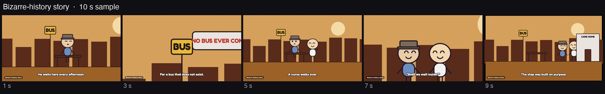

# Bizarre-history story

A true story with a contradiction built in: someone does something that looks cruel, stupid or illegal, and the reason turns out to be clever or kind. Cartoon figures, quick beats, a wry voice.

- **Pack and engine**: code-explainer · Remotion for the diagrams, canvas for acted scenes
- **Good length**: 1–3 min
- **Skill reference**: `references/styles/code-explainer.md`

## See it



10-second clip: [`samples/bizarre-history-story.mp4`](samples/bizarre-history-story.mp4). A code-drawn look sample; a real film has voice and sound and is built on this style's own engine.

## Tell Claude

- the story, or just the kind of contradiction you like
- who the central figure is (drawn as an original cartoon, never a real likeness)
- how the last line should feel: ironic, warm or dark

## Prompts to copy

```
/vault-film bizarre-history story, 2 minutes: the fake bus stops outside care homes. Wry voice, verify every fact first.
```
```
/vault-film 10 true bizarre-history ideas with a built-in contradiction, in the grammar of my vault notes "08 - Celyxi" and "10 - Knackery". Mark each true, disputed or legend.
```
```
/vault-film bizarre-history story about a parable with a refrain (pick one from another culture), 90 seconds, repeat the refrain in the same calm tone each time.
```

## Steering it while it builds

- `slow down just before the reveal`
- `the character should act the surprise, not a caption`
- `cut the middle, it explains what we can already see`

## Watch for

- These stories spread because they sound too good. Ask: `which of these facts is disputed?`
