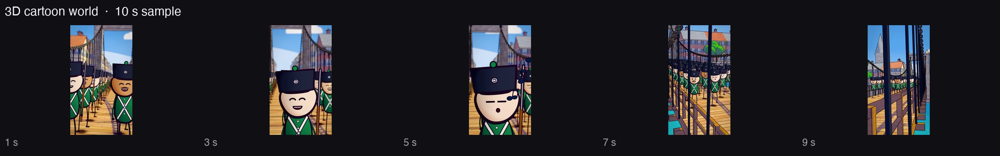

# 3D cartoon world

Flat bean-headed cartoon characters standing in a painted 3D town: black ink outlines, saturated sky, soft background blur, gliding cameras. The template is a finished 67-second vertical short; you bring a new story, sets and cast.

- **Pack and engine**: code-explainer · Remotion with three.js (`templates/remotion/cartoon3d/`)
- **Good length**: 1–2 min; it is the slowest style to build and render
- **Skill reference**: `references/styles/code-explainer.md`

## See it



10-second clip: [`samples/cartoon-3d-world.mp4`](samples/cartoon-3d-world.mp4). Rendered from the real three.js template.

## Tell Claude

- one surprising true story with a physical cause, and an everyday comparison that explains it
- the setting (year, place) and the crowd
- vertical or wide

## Prompts to copy

```
/vault-film 3D cartoon world, 70 seconds, vertical: a true story where a crowd walking in step broke something. Use the cartoon3d template's look, new story and sets.
```
```
/vault-film before planning, render 3 stills of the cartoon3d template so I can see the look in this workspace.
```
```
/vault-film 3D cartoon world for chapter 2 only; the rest of the film is a schematic explainer.
```

## Steering it while it builds

- `golden light for the turn, day light before it`
- `camera lower, rails should cross the legs not the faces`
- `less blur on the wide shots`

## Watch for

- The template's tree, stall and lantern models are not included; those props are left out until you add them.
- Long sessions: ask for the effort estimate first.
