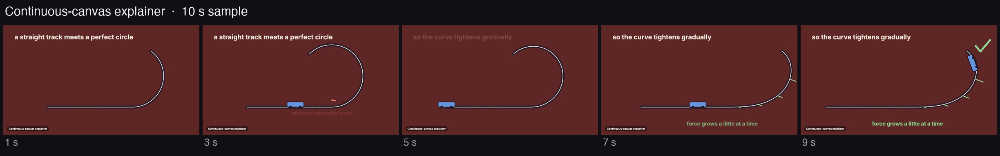

# Continuous-canvas explainer

One drawing that never cuts away: the camera pans and the diagram morphs from one idea into the next. Built for counter-intuitive physics hiding in everyday objects.

- **Pack and engine**: code-explainer · Remotion
- **Good length**: 1–3 min
- **Skill reference**: `references/styles/code-explainer.md`

## See it



10-second clip: [`samples/continuous-canvas-explainer.mp4`](samples/continuous-canvas-explainer.mp4). A code-drawn look sample; a real film has voice and sound and is built on this style's own engine.

## Tell Claude

- the everyday object and the false assumption people hold about it
- the real mechanism in one sentence
- where the viewer can see it in real life (the closing line)

## Prompts to copy

```
/vault-film continuous-canvas explainer, 75 seconds: why train wheels are cones, not cylinders. Casual voice.
```
```
/vault-film continuous-canvas explainer in the grammar of my vault note "09 - Ricks Clips": why highway ramps are never circles. One unbroken canvas.
```
```
/vault-film 10 ideas for continuous-canvas explainers about invisible engineering in a kitchen
```

## Steering it while it builds

- `no hard cuts at all, morph the circle into the spiral`
- `add force arrows on the passenger`
- `end by zooming out to the real ramp, matching the first frame`

## Watch for

- It needs a subject that is one connected picture; a list of facts suits the schematic explainer better.
