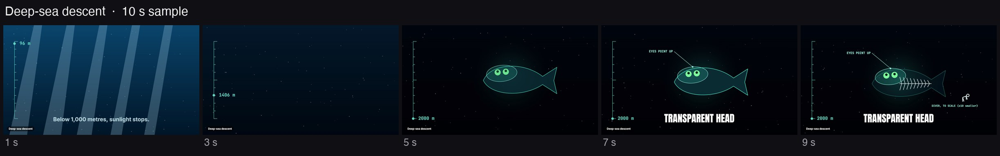

# Deep-sea descent

A dark nature explainer built as a descent: each zone or fact stranger than the last, with glowing X-ray anatomy, bold 2–4 word fact captions and every size set beside a familiar object.

- **Pack and engine**: code-explainer · Remotion
- **Good length**: 2–8 min
- **Skill reference**: `references/styles/code-explainer.md`

## See it



10-second clip: [`samples/deep-sea-descent.mp4`](samples/deep-sea-descent.mp4). A code-drawn look sample; a real film has voice and sound and is built on this style's own engine.

## Tell Claude

- the animal or environment
- the one adaptation that seems impossible
- the comparison objects (a diver, a bus)

## Prompts to copy

```
/vault-film deep-sea descent, 3 minutes: how the barreleye fish sees through its own head. X-ray reveal, fact captions.
```
```
/vault-film deep-sea descent using my vault note "05 - Educational Nature & Deep-Sea Visual Strategist Framework": offer niches, then 10 ideas, then the script.
```
```
/vault-film deep-sea descent, 5 minutes, five depth zones as five chapters
```

## Steering it while it builds

- `open in darkness and pressure before showing the animal`
- `put a diver silhouette next to it for scale`
- `caption in caps, three words at most`

## Watch for

- Every measurement needs a source; ask for the sources table with the script.
