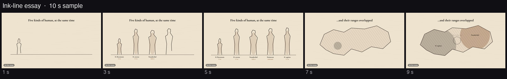

# Ink-line essay

Black, white and sepia line drawings like a field journal: silhouettes lined up for comparison, migration maps, a calm lecturer's voice. Suits science and deep history at length.

- **Pack and engine**: code-explainer · Remotion (maps, type) with canvas for drawn figures
- **Good length**: 4–8 min
- **Skill reference**: `references/styles/code-explainer.md`

## See it



10-second clip: [`samples/ink-line-essay.mp4`](samples/ink-line-essay.mp4). A code-drawn look sample; a real film has voice and sound and is built on this style's own engine.

## Tell Claude

- the question the essay answers
- the comparisons you want lined up (sizes, dates, species)
- the closing thought

## Prompts to copy

```
/vault-film ink-line essay, 6 minutes: why only one human species is left. Calm historian voice, silhouettes side by side, maps without borders.
```
```
/vault-film ink-line essay from my vault note "Why Are We the Only Human Species Left": same grammar, new question about the domestication of the horse.
```
```
/vault-film ink-line essay, 3 storylines for: how writing was invented three separate times
```

## Steering it while it builds

- `one sepia accent only`
- `hold the silhouette line-up longer`
- `say which theory is most supported and which is speculation`

## Watch for

- Long essays: ask for the chapter plan with a rehook at the end of each chapter.
