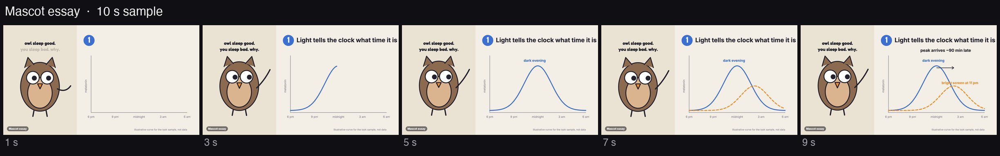

# Mascot essay

One crude, likeable mascot explains real science in plain words, beside crisp diagrams. Numbered protocols, each a wild-versus-modern comparison.

- **Pack and engine**: character-comedy · canvas for the mascot, Remotion for diagrams
- **Good length**: 4–8 min
- **Skill reference**: `references/styles/character-comedy.md`

## See it



10-second clip: [`samples/mascot-essay.mp4`](samples/mascot-essay.mp4). A code-drawn look sample; a real film has voice and sound and is built on this style's own engine.

## Tell Claude

- the mascot (an original one) and how it talks
- the 4–6 protocols or points
- the exact numbers each one rests on

## Prompts to copy

```
/vault-film mascot essay, 5 minutes: five habits for good sleep, explained by an original owl mascot who speaks in short flat sentences.
```
```
/vault-film mascot essay in the grammar of my vault note "04 - Monke", but with my own mascot. Topic: how to learn a hard skill. Source every claim.
```
```
/vault-film design 3 mascot options with a model sheet each before we write
```

## Steering it while it builds

- `mascot on the left, diagram on the right`
- `keep the odd grammar consistent`
- `cut any claim that has only one weak source`

## Watch for

- Health claims need strong sources; ask for the status column (true, disputed).
