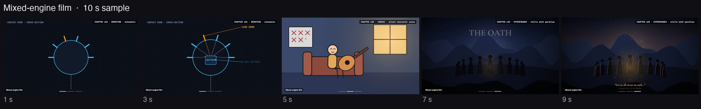

# Mixed-engine film

One film, several engines. Each chapter is built where it works best, then all chapters are joined with one look and one sound mix.

- **Pack and engine**: any pack · Remotion, canvas and HyperFrames by chapter
- **Good length**: 3–8 min
- **Skill reference**: `references/mixing-engines.md`

## See it



10-second clip: [`samples/mixed-engine-film.mp4`](samples/mixed-engine-film.mp4). A code-drawn look sample; a real film has voice and sound and is built on this style's own engine.

## Tell Claude

- the main style, then which parts should be something else and why
- one palette and font feel for the whole film

## Prompts to copy

```
/vault-film 5 minute untold saga on my stills; make the map and battle-plan part a schematic explainer chapter and the final scene a silent character moment.
```
```
/vault-film plan the chapters for my script and tell me which engine each should use and why. Use as few engines as the film needs.
```
```
/vault-film show me a look proof with one frame from each engine side by side before building anything
```

## Steering it while it builds

- `change chapter 4 to canvas`
- `the join between c02 and c03 jumps, make it a dip`
- `the two engines' blues don't match, fix the look`

## Watch for

- More engines means more joins to get right. Two is normal; ask Claude to justify a third.
