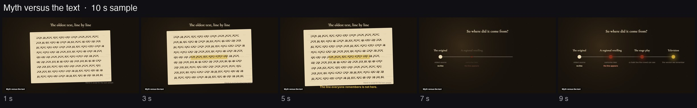

# Myth versus the text

A belief everyone holds, checked against its oldest source. The passage appears on screen with the key phrase highlighted, then a timeline shows where the popular version came from.

- **Pack and engine**: saga · HyperFrames, with Remotion chapters for text, timelines and maps
- **Good length**: 5–8 min
- **Skill reference**: `references/styles/saga.md`

## See it



10-second clip: [`samples/myth-vs-text.mp4`](samples/myth-vs-text.mp4). A code-drawn look sample; a real film has voice and sound and is built on this style's own engine.

## Tell Claude

- the belief and the original text
- the later retellings that added it
- respectful tone: what the change tells us, not a debunk

## Prompts to copy

```
/vault-film myth versus the text, 6 minutes: a famous detail that is not in the original epic. Historian voice, quote the passage, timeline of retellings.
```
```
/vault-film myth versus the text in the grammar of my vault note "The Lakshman Rekha Was NEVER Drawn", new subject. Sources with chapter and verse.
```
```
/vault-film myth versus the text: 10 ideas from history, each with the popular version and what the source says
```

## Steering it while it builds

- `highlight the exact phrase in the accent colour`
- `silence after the finding`
- `make the timeline a Remotion chapter`

## Watch for

- Use public-domain paintings and translations only; ask for the licence column.
