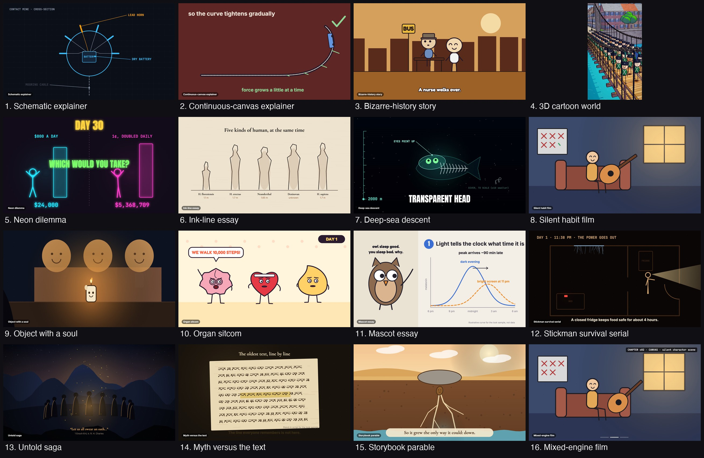

# Animation style names

Watch them: open `samples/index.html` in a browser (16 looping 10-second clips), or play `samples/<style>.mp4`. Each style also has a five-frame sheet in `samples/sheets/`.

Use any of these names in a prompt. Each has a file here with what it is, what to tell Claude, and prompts to copy.

| Say this | File | What you get | Pack · engine | Voice |
|---|---|---|---|---|
| schematic explainer | `schematic-explainer.md` | blueprint cutaways, parts that spring in, labels, counters | code-explainer · Remotion | deadpan narrator |
| continuous-canvas explainer | `continuous-canvas-explainer.md` | one drawing that pans and morphs, almost no cuts | code-explainer · Remotion | friend-at-a-bar narrator |
| bizarre-history story | `bizarre-history-story.md` | fast-cut cartoon story with a built-in contradiction | code-explainer · Remotion or canvas | wry storyteller |
| 3D cartoon world | `cartoon-3d-world.md` | flat cartoon characters in a painted 3D town, ink outlines, lens blur | code-explainer · Remotion + three.js | steady narrator |
| neon dilemma | `neon-dilemma.md` | two players, one deal, neon figures on black | code-explainer · Remotion | game-master narrator |
| ink-line essay | `ink-line-essay.md` | black, white and sepia line drawings, maps, silhouettes | code-explainer · Remotion or canvas | calm lecturer |
| deep-sea descent | `deep-sea-descent.md` | dark nature explainer: X-ray reveals, size comparisons, fact captions | code-explainer · Remotion | suspense documentary |
| silent habit film | `silent-habit-film.md` | wordless 2D film, grey turning to colour | silent-film · canvas | none |
| object with a soul | `object-with-a-soul.md` | wordless film seen from a small object's point of view | silent-film · canvas | none |
| organ sitcom | `organ-sitcom.md` | a system as bickering cartoon characters | character-comedy · canvas | a voice per character |
| mascot essay | `mascot-essay.md` | one crude, likeable mascot explains real science | character-comedy · canvas + Remotion | one deadpan narrator |
| stickman survival serial | `stickman-survival-serial.md` | "you" in a slow disaster, dark rooms and floor plans | character-comedy · canvas | calm, tense narrator |
| untold saga | `untold-saga.md` | long narrated drama on your illustrated stills | saga · HyperFrames | chronicler |
| myth versus the text | `myth-vs-text.md` | a belief checked against its oldest source | saga · HyperFrames + Remotion | historian |
| storybook parable | `storybook-parable.md` | gentle fable on painted stills with slow parallax | saga · HyperFrames | storybook |
| mixed-engine film | `mixed-engine-film.md` | any of the above combined chapter by chapter | any | any |

Not sure which: describe the video and add `which style fits?`
