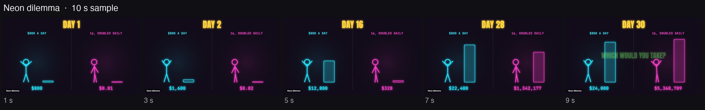

# Neon dilemma

Two simple neon characters on a near-black stage take two sides of one deal. Counters tick, days pass, the gap between them grows, and the ending is not what the opening promised.

- **Pack and engine**: code-explainer · Remotion
- **Good length**: 1:40–2:30
- **Skill reference**: `references/styles/code-explainer.md`

## See it



10-second clip: [`samples/neon-dilemma.mp4`](samples/neon-dilemma.mp4). A code-drawn look sample; a real film has voice and sound and is built on this style's own engine.

## Tell Claude

- the deal and its hidden catch
- the two players (the impulsive one and the patient one)
- the day or stage where temptation hits

## Prompts to copy

```
/vault-film neon dilemma, 2 minutes: one cent doubling daily against a salary, with a catch that spending shrinks the pool. Two players.
```
```
/vault-film neon dilemma in the grammar of my vault note "06 - MRAKOPYS", new premise: every hour of sleep you skip is paid back double later. Check the maths.
```
```
/vault-film 10 neon dilemma premises that rest on real maths or real psychology
```

## Steering it while it builds

- `show both players at once, split screen`
- `the music should tighten as the days pass`
- `end on the question, no moral`

## Watch for

- The maths must hold: ask `show me the day-by-day table before the script`.
