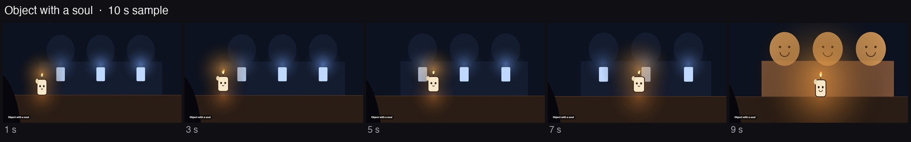

# Object with a soul

A wordless film from the point of view of a small object (a candle, a watch, a blank notebook) whose physical nature is the metaphor. Stairs are cliffs, a cat is a predator.

- **Pack and engine**: silent-film · canvas
- **Good length**: 3–6 min
- **Skill reference**: `references/styles/silent-film.md`

## See it



10-second clip: [`samples/object-with-a-soul.mp4`](samples/object-with-a-soul.mp4). A code-drawn look sample; a real film has voice and sound and is built on this style's own engine.

## Tell Claude

- the object and what it physically gives or loses
- the human world it looks at
- the moment it matters

## Prompts to copy

```
/vault-film object with a soul, 4 minutes: an old radio in a house where everyone wears headphones. No voice.
```
```
/vault-film object with a soul, 3 storylines for a mechanical watch in a drawer
```
```
/vault-film object with a soul as the last chapter of my saga; canvas engine, 40 seconds
```

## Steering it while it builds

- `keep the camera at the object's height`
- `warm light only from the object`
- `the humans never look at camera`

## Watch for

- Design an object of your own; do not reuse a reference film's character.
