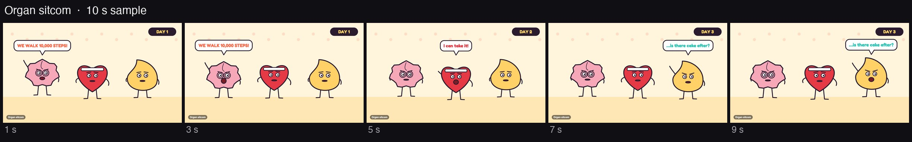

# Organ sitcom

A system (a body, a computer, a cell) played as bickering cartoon characters, each with one flaw and one voice. Every fact arrives as the punchline of an argument, on a ticking clock.

- **Pack and engine**: character-comedy · canvas
- **Good length**: 2:20–5:30
- **Skill reference**: `references/styles/character-comedy.md`

## See it



10-second clip: [`samples/organ-sitcom.mp4`](samples/organ-sitcom.mp4). A code-drawn look sample; a real film has voice and sound and is built on this style's own engine.

## Tell Claude

- the system and the challenge it faces
- the cast (3–5 parts) and each one's flaw
- the clock (hours, days, stages)

## Prompts to copy

```
/vault-film organ sitcom, 3 minutes: your organs during a night with no sleep. Brain, heart, stomach, eyes. Hour by hour.
```
```
/vault-film organ sitcom in the grammar of my vault note "03 - CasiCreativo": a laptop's parts with 50 browser tabs open. Original cast, a voice each.
```
```
/vault-film organ sitcom: write the voice sheets for the cast first, then audition voices
```

## Steering it while it builds

- `the liver and the brain sound too alike, change one voice`
- `give that gag half a second more`
- `end on a button line and a freeze`

## Watch for

- More than five voices blur. Keep the cast for the next episode: `save the rigs and voices as this channel's cast`.
