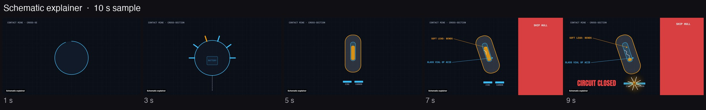

# Schematic explainer

Every frame drawn in code on a dark blueprint ground: an object is cut open, its outer wall fades, and the mechanism inside moves in time with the words. Exact names, dates and numbers. Fast cuts, something new on screen about every second.

- **Pack and engine**: code-explainer · Remotion
- **Good length**: 1–4 min; longer works as several mechanism chapters
- **Skill reference**: `references/styles/code-explainer.md`

## See it



10-second clip: [`samples/schematic-explainer.mp4`](samples/schematic-explainer.mp4). A code-drawn look sample; a real film has voice and sound and is built on this style's own engine.

## Tell Claude

- the object or event, and the one surprising thing about it
- the mechanism you want shown in cross-section
- any numbers that must appear on screen (they need sources)

## Prompts to copy

```
/vault-film schematic explainer, 90 seconds: why sea mines have spikes. Show the horn in cross-section.
```
```
/vault-film schematic explainer from my vault note "11 - Segment Zero". New topic: how the Carpathia got 3.5 knots over her top speed. 2 minutes, historian voice.
```
```
/vault-film 4 minute schematic explainer about how a power grid fails, in 4 chapters, one mechanism each. Give me 3 storylines first.
```

## Steering it while it builds

- `slow the cuts in chapter 2, let the diagram breathe`
- `make the cutaway bigger, it should fill two thirds of the frame`
- `add a source card under the 58 nautical miles figure`
- `warmer ground colour, keep the three accents`

## Watch for

- A film at one even speed: ask for one held chapter among the fast ones.
- Labels too small to read on a phone: ask for the contact sheet and check them.
