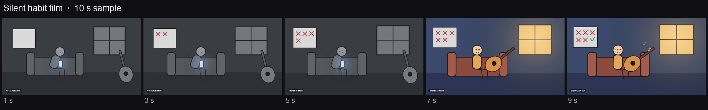

# Silent habit film

No voice at all. A person, one prop, a private failure the viewer recognises, and a turn made by a very small step. The world starts grey and colour comes back.

- **Pack and engine**: silent-film · canvas
- **Good length**: 2:30–6 min
- **Skill reference**: `references/styles/silent-film.md`

## See it



10-second clip: [`samples/silent-habit-film.mp4`](samples/silent-habit-film.mp4). A code-drawn look sample; a real film has voice and sound and is built on this style's own engine.

## Tell Claude

- the silent shame (the habit, the phone, feeling behind)
- the prop that stands for who they want to be
- the tiny step that turns it

## Prompts to copy

```
/vault-film silent habit film, 3 minutes: someone who bought a guitar a year ago and has never played it. No voice, grey to colour.
```
```
/vault-film silent habit film in the grammar of my vault notes in "01 Animated Short Films". New human, new prop, new turn. Show me the beat sheet first.
```
```
/vault-film 10 silent film ideas about feeling behind your friends, each with its prop and its small step
```

## Steering it while it builds

- `more time on the failure, at least a third of the film`
- `no text on screen except inside the world`
- `music only in the last 40%`
- `end on a physical action, not a title`

## Watch for

- Ask for the mute test: the contact sheets alone should tell the story.
- Acted character animation is the most work per second; ask for the effort estimate.
