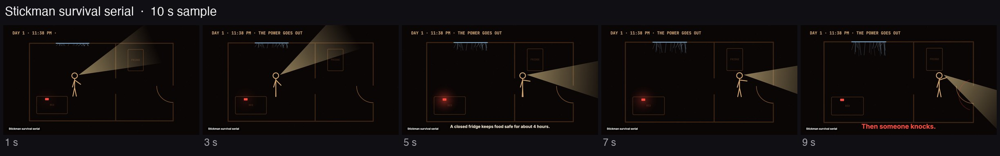

# Stickman survival serial

You are a stick figure in a slow disaster. Dark rooms, floor plans, torch beams. The story is fiction, the survival rules are real and arrive inside the suspense. Told in parts.

- **Pack and engine**: character-comedy · canvas
- **Good length**: 5–6 min per part
- **Skill reference**: `references/styles/character-comedy.md`

## See it



10-second clip: [`samples/stickman-survival-serial.mp4`](samples/stickman-survival-serial.mp4). A code-drawn look sample; a real film has voice and sound and is built on this style's own engine.

## Tell Claude

- the disaster and the place
- the day range for this part
- the real guidance to weave in

## Prompts to copy

```
/vault-film stickman survival serial, part 1, 5 minutes: 100 days without power in an ice storm, days 1–10. Second person, exact times.
```
```
/vault-film stickman survival serial in the grammar of my vault note "07 - Hundred Days In": a flood in an apartment block. Plan 4 parts, write part 1.
```
```
/vault-film cut the tensest 50 seconds of part 1 as a Short that ends before the door opens
```

## Steering it while it builds

- `start each beat with the time`
- `one locked camera for the whole room`
- `end the part on the knock`

## Watch for

- Safety facts must come from public guidance, cited in the sources file.
