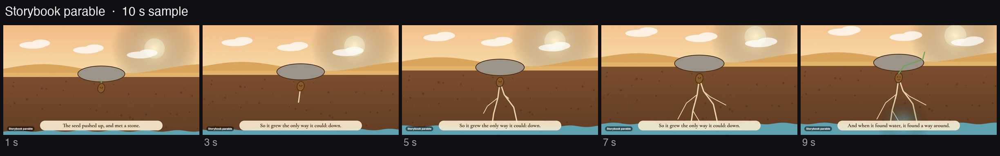

# Storybook parable

A gentle fable on painted stills with slow parallax and a warm storyteller's voice. Often a cross-section: what happens above ground and what happens below.

- **Pack and engine**: saga · HyperFrames
- **Good length**: 3–6 min
- **Skill reference**: `references/styles/saga.md`

## See it



10-second clip: [`samples/storybook-parable.mp4`](samples/storybook-parable.mp4). A code-drawn look sample; a real film has voice and sound and is built on this style's own engine.

## Tell Claude

- the fable and its one-line lesson (shown, never preached)
- the setting and the central image
- that you will make the stills

## Prompts to copy

```
/vault-film storybook parable, 4 minutes: a seed under a stone that grows roots before it grows up. Storybook voice, my stills.
```
```
/vault-film storybook parable from my vault note "Your Struggle Is Your Power": same grammar, a new fable about a river and a dam.
```
```
/vault-film storybook parable, write it so a child and an adult both get something
```

## Steering it while it builds

- `slower, more pauses`
- `split the frame: above ground and below`
- `no moral spoken at the end, let the last image carry it`

## Watch for

- Keep one art style sentence for every image so the stills match.
