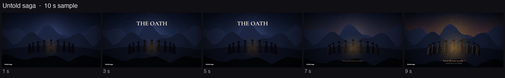

# Untold saga

A long narrated drama over your illustrated stills: a story people know in a tidy version, retold with its real stakes. Slow pushes and parallax, a chronicler's voice, one moment of silence at the turn.

- **Pack and engine**: saga · HyperFrames
- **Good length**: 5–8 min
- **Skill reference**: `references/styles/saga.md`

## See it



10-second clip: [`samples/untold-saga.mp4`](samples/untold-saga.mp4). A code-drawn look sample; a real film has voice and sound and is built on this style's own engine.

## Tell Claude

- the story and the source text (with its translation)
- who the human at the centre is
- that you will make the stills (about one per 5–12 seconds)

## Prompts to copy

```
/vault-film untold saga, 7 minutes: the story of Tamar from Genesis 38, on my own stills. Chronicler voice, public-domain translation.
```
```
/vault-film make my vault script "7-Minute Master Recreation Script - The Oath on Mount Hermon" into a saga. Lint it, voice it, give me the art board.
```
```
/vault-film untold saga, 3 storylines for: the siege where a city was saved by its geese
```

## Steering it while it builds

- `open the art board` (to copy prompts and drop in images)
- `shot 14 image is in, rebuild chapter 3`
- `say plainly which parts are legend`
- `the verse holds still for 3 seconds`

## Watch for

- Words like banned or hidden need a source; ask `is that claim supported?`
- Missing stills show as red placeholder tiles; none may reach the final.
